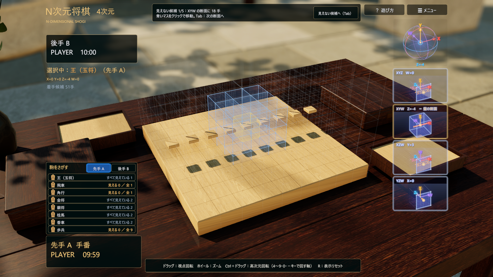
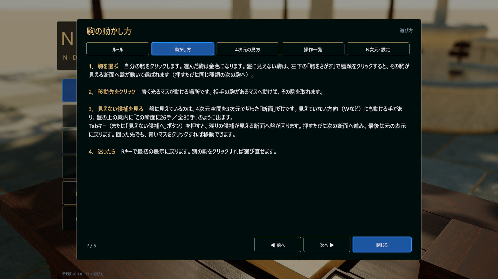

# N次元将棋（N-Dimensional Shogi）— デモ版

4次元以上の盤で指す将棋です。盤に見えているのは N 次元空間を 3 次元で切った「断面」で、見えていない方向にも駒が動けます。3〜11 次元まで選べます。



> **English:** A shogi variant played on a 4- to 11-dimensional board. The board you see is a 3D cross-section of the N-dimensional space; pieces can also move along the hidden axes. Windows only. Download the zip from [Releases](https://github.com/piperendervt-glitch/n-dimensional-shogi-showcase/releases/latest), unzip it and run `NDShogi.exe`. The in-game text is Japanese; press F1 for the how-to-play pages.

## ダウンロードと起動

1. [Releases](https://github.com/piperendervt-glitch/n-dimensional-shogi-showcase/releases/latest) から `NDShogi-Windows.zip` をダウンロードして展開します。
2. `NDShogi.exe` をダブルクリックします。
3. 「Windows によって PC が保護されました」と出たときは「詳細情報」→「実行」を押してください（署名のない個人制作のアプリのため表示されます）。

初めて起動すると「遊び方」が開きます。あとからはメニューの「遊び方」か F1 キーで開けます。

**動作環境**：Windows 10 / 11（64 ビット）、DirectX 12 に対応した GPU、空き容量 約 600 MB。ノート PC の内蔵 GPU では重いことがあります。そのときはオプション →「表示・操作」→「画質」で「低」を選んでください。

## 遊び方

- **勝ち負け**：相手の王を取れば勝ち。持ち時間が 0 になると負け、動ける手がなければ引き分けです。成り・持ち駒・千日手はなく、王手を放置しても反則になりません（自分の王が狙われると画面上部に赤字で知らせます）。
- **駒を動かす**：自分の駒をクリックし、青く光るマスをクリックします。
- **見えない候補**：盤に見えていない方向にも動ける手があります。**Tab** を押すと、残りの候補が見える断面へ盤が回ります。押すたびに次の断面へ進み、最後は元の表示に戻ります。
- **見えない駒**：左下の「駒をさがす」で種類をクリックすると、その駒が見える断面へ盤が動いて選ばれます。
- **次元を変える**：メニューの「次元」の − ＋ で 3〜11 次元を選べます。初めてなら 4 次元がおすすめです。

| 操作 | 内容 |
|---|---|
| 左クリック | 駒を選ぶ・動かす |
| Tab | 選んだ駒の見えない候補が見える断面へ |
| R | 最初の表示に戻す |
| 左ドラッグ／右ドラッグ、ホイール | 視点を回す、拡大・縮小 |
| 中ドラッグ／Shift＋左ドラッグ | 平行移動 |
| Ctrl＋左ドラッグ（Shift も押すと別の向き） | 盤を 4 次元で回す。4〜9・0・− キーで回す相手の軸を選ぶ |
| 右上の球の軸名クリック／軸ドラッグ | その軸が入った断面へ／断面を平行に動かす |
| 右の小さな図 | クリックで盤をその断面に。マウスを乗せると拡大、右クリックで固定 |
| F1／Esc | 遊び方／戻る（対局中は中断の確認があります） |



## 保存先と不具合の報告

設定と棋譜は `%USERPROFILE%\AppData\LocalLow\piperendervt-glitch\四次元将棋` に保存されます。うまく動かないときは、同じ場所の `Player.log` を添えて [Issues](https://github.com/piperendervt-glitch/n-dimensional-shogi-showcase/issues) へお知らせください。

## ソースからビルドする

リポジトリは計測記録（`evidence/`）を含むため約 1.3 GB あります。遊ぶだけなら Releases の zip を使ってください。

1. Unity 6000.3.11f1（HDRP 17.3.0）をインストールします。
2. `Build.cmd` をダブルクリックします（数分かかります）。`release\NDShogi\NDShogi.exe` と配布用の `release\NDShogi-Windows.zip` ができます。
3. `Play.cmd` で起動します。

Unity に依存しないルール・幾何の部分は .NET 9 SDK で試験できます。

```powershell
dotnet run --project tests/Showcase.Core.Tests -c Release -- evidence/core
dotnet run --project tests/Showcase.Geometry.Tests -c Release -- evidence/geometry
```

試験用の厳密な起動（`--pivot-request-id` などの識別用引数を付けた起動）では、ビルドとソースの照合を行います。

## フォルダ構成

| 場所 | 内容 |
|---|---|
| `Build.cmd` / `Play.cmd` | ビルド／起動用（ダブルクリック） |
| `Unity/` | Unity プロジェクト（N次元将棋の `Cfg2` シーンと、旧 Showcase デモ） |
| `src/` | Unity に依存しないルール・幾何ライブラリ（Core / Geometry） |
| `tests/` | 純 C#・Python の試験 |
| `tools/` | ビルド・計測スクリプト（`build-game.ps1` が N次元将棋、`dist/` が配布 zip に入れる説明書き） |
| `scenarios/`, `assets/` | 棋譜・シナリオ、素材の原本と出典 |
| `docs/` | 設計・性能の文書。旧 Showcase デモの説明は [docs/SHOWCASE_DEMO_JA.md](docs/SHOWCASE_DEMO_JA.md)、各作業回の記録は `docs/history/` |
| `evidence/` | 計測・検証の記録 |
| `release/` | ビルド出力（git 管理外） |

## ライセンス

このリポジトリのソースコード・文書・自作素材（手続き生成の盤・駒・庭、`tools/synth_audio.py` で合成した効果音・BGMを含む）は [MIT License](LICENSE) で提供します。

次のものはMIT Licenseの対象外で、それぞれ元の条件に従います。配布 zip には同じ内容を `THIRD_PARTY_NOTICES.txt` として入れています。

- Poly Havenのテクスチャ（原本と加工後の画像）：[CC0-1.0](https://polyhaven.com/license)。出典は [NOTICE.txt](assets/source/polyhaven/NOTICE.txt) と [provenance.json](assets/source/polyhaven/provenance.json) を参照してください。
- 駒名テクスチャ（`Unity/Assets/Showcase/Resources/PieceTextures`）：Windows付属の游明朝で描いた文字画像です。本ゲームの一部としての利用に限り、文字画像を単独の素材として再利用することは許諾しません。
- Unity エンジンと Unity 公式パッケージ：Unity の各ライセンスに従います。
